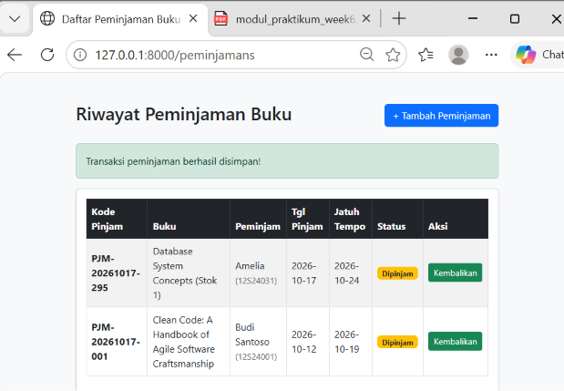
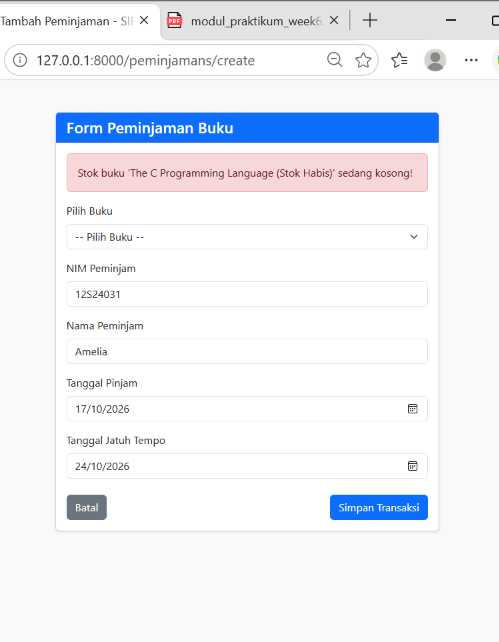
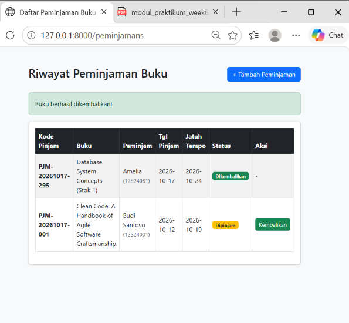
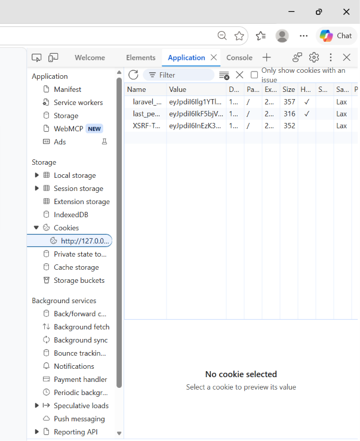

# Tugas Mandiri Praktikum PPW Week 6 - Pembangunan Sistem Informasi Perpustakaan Kampus Del (SIPUS-Del)

Repositori ini berisi pengerjaan Tugas Mandiri Praktikum **Pemrograman dan Pengujian Aplikasi Web (PPW)** Minggu 06, Program Studi S1 Sistem Informasi - Institut Teknologi Del.

## 👤 Identitas Mahasiswa
- **Nama:** Amelia Renata Lumbanbatu
- **NIM:** 12S24031
- **Program Studi:** S1 Sistem Informasi (2024)
- **Institusi:** Institut Teknologi Del
- **LinkedIn:** [Amelia Renata Lumbanbatu](https://www.linkedin.com/in/amelia-renata-lumbanbatu-867936364)

---

## 🔐 Kredensial Uji Pustakawan
- **Email:** `pustakawan@del.ac.id`
- **Password:** `password123`

---

## 🛠️ Implementasi Spesifikasi Modul 6
1. **Skema Tabel Transaksi & Relasi Eloquent:**
   - Membuat migrasi tabel `peminjamans` dengan *foreign key* `buku_id` (`cascadeOnDelete`), kode pinjam unik, status peminjaman, serta pencatatan timestamp.
   - Definisi relasi *One-to-Many* (`hasMany` pada Model Buku dan `belongsTo` pada Model Peminjaman).

2. **Transaksi Basis Data ACID & Concurrency Locking:**
   - Pembungkusan transaksi peminjaman dan pengembalian di dalam `DB::transaction()` dan `lockForUpdate()` (Pessimistic Locking) untuk mencegah *race condition*.
   - Validasi ketersediaan stok (> 0), penolakan transaksi jika stok habis, serta pencegahan NIM yang sama meminjam buku yang sama yang belum dikembalikan.
   - Pencatatan otomatis timestamp `tanggal_kembali` saat pengembalian dan penanganan `QueryException` yang dicatat ke `Log::error()`.

3. **Fluent Query Builder & Filter Dinamis:**
   - Katalog buku menggunakan `withCount('peminjamans')`, filter pencarian dinamis `when()` (judul, penulis, ISBN, kategori), dan paginasi `withQueryString()`.
   - Ringkasan dashboard dan laporan statistik perpustakaan dihitung menggunakan `DB::table()` (Total Judul, Total Stok, Total Dipinjam, Total Dikembalikan).

4. **Manajemen Sesi Pengguna & Autentikasi Pustakawan:**
   - `AuthController` menangani proses Login dan Logout menggunakan `Auth::attempt()`.
   - Penerapan `session()->regenerate()` saat login untuk mencegah *Session Fixation*, serta `Cookie::queue()` untuk menyimpan jejak aktivitas HTTP Cookie.
   - Proteksi seluruh rute transaksi dan mutasi data menggunakan *middleware* `auth`.

5. **Seeder Uji & Dokumentasi Audit:**
   - `UserSeeder` untuk menyuntikkan akun Pustakawan uji.
   - `BukuSeeder` yang menyediakan data sampel buku dengan stok = 0 (uji penolakan), stok = 1 (uji penguncian concurrency), serta sampel riwayat transaksi.

---

## 🌐 Akses Halaman Web (Routes Terproteksi)
Setelah menjalankan `php artisan serve`, rute sistem dapat diakses melalui peramban:

- **Halaman Login Pustakawan:** `http://127.0.0.1:8000/login`
- **Katalog Buku:** `http://127.0.0.1:8000/buku` *(Memerlukan Auth)*
- **Kategori Buku:** `http://127.0.0.1:8000/kategori` *(Memerlukan Auth)*
- **Sirkulasi Peminjaman:** `http://127.0.0.1:8000/peminjamans` *(Memerlukan Auth)*
- **Laporan Statistik:** `http://127.0.0.1:8000/laporan` *(Memerlukan Auth)*

---

## 📷 Bukti Pengujian & Audit DevTools

### 1. Bukti Transaksi Peminjaman Buku Berhasil

### 2. Bukti Penolakan Transaksi (Stok Buku = 0)

### 3. Bukti Pengembalian Buku & Pembaruan Stok

### 4. Audit Cookie HttpOnly & Session pada Browser DevTools
